# Plant Succession ML Project

An independent longitudinal field-data engineering project tracking vegetation change across disturbed
urban edge habitats in Phoenixville, Pennsylvania.

The pipeline converts a real archive of repeatable field photography into sanitized relational tables,
photo-backed observation records, validation results, and reproducible longitudinal outputs. The image
archive can support later computer-vision experiments, but the current portfolio focus is data engineering.

**11 sites | 74 photo-backed observations | 589 verified field photos | May 25-October 17, 2026**

## Project Status

The photo archive has been inventoried and normalized into a public metadata manifest. One
observation is generated for each non-empty site/date photo batch, then reviewed against the source
images before ecological fields and photo roles are published.

Current implemented assets:

- 11 monitoring sites, including one later-established sensitive-fern disturbance site
- A local FastAPI ingestion service with private staging, review queues, and validated publication
- Content-hash duplicate detection, HEIC previews, private EXIF site/date suggestions, and per-file batch-integrity checks
- Append-only review events that keep rule/model suggestions separate from human verification
- A structured Google Form for site observations
- A Google Sheets workbook with review, source-note, site-check, and disturbance-event tables
- Repeatable photo protocols for wide, quadrat, close-up, and context photos
- Initial schema design for ecological observations and disturbance history
- A sanitized 589-row photo manifest with deterministic IDs and logical archive paths
- A 74-row observation table derived from photo-backed site visits, with explicit provenance
- A 74-row upload-batch summary used to audit completeness independently of observation content
- Validation for identifiers, site references, dates, counts, classification state, and private-link leakage
- A private Google Sheets review workbook synchronized with the public CSV structure
- Completed photo-role reviews for Sites 1-11, with 589 verified roles; 63 historical observations also have uncertainty-aware cover estimates
- 11 preserved field notes normalized into 16 explicit site checks and 15 disturbance events
- Source-note lineage that keeps unmentioned sites unknown and separates phenology from disturbance
- A reproducible analysis-ready join with explicit completeness and longitudinal fields
- Generated cover-change figures for the completed Site 1-11 sequences

The project does not yet include a trained machine-learning model. Camera order is not treated as a
reliable photo label; all published roles were assigned through visual review. Disturbance records are
derived only from explicit field notes or separately documented photo evidence.

## Ingestion Service

New monitoring rounds can be staged and reviewed through an upload app instead of Google Forms or
manual CSV editing. Originals stay outside Git, while human-verified roles and deterministic identifiers
flow into the same validated public tables used by the analysis pipeline.

Selecting photos reads their EXIF capture timestamps and GPS coordinates, then prefills the most likely
observation date and monitoring site. Exact site anchors remain in an ignored private file, suggestions
show confidence and distance, and the user confirms or corrects both fields before staging. A batch-integrity
gate names individual site/date exceptions and requires an explicit override before they can enter review.

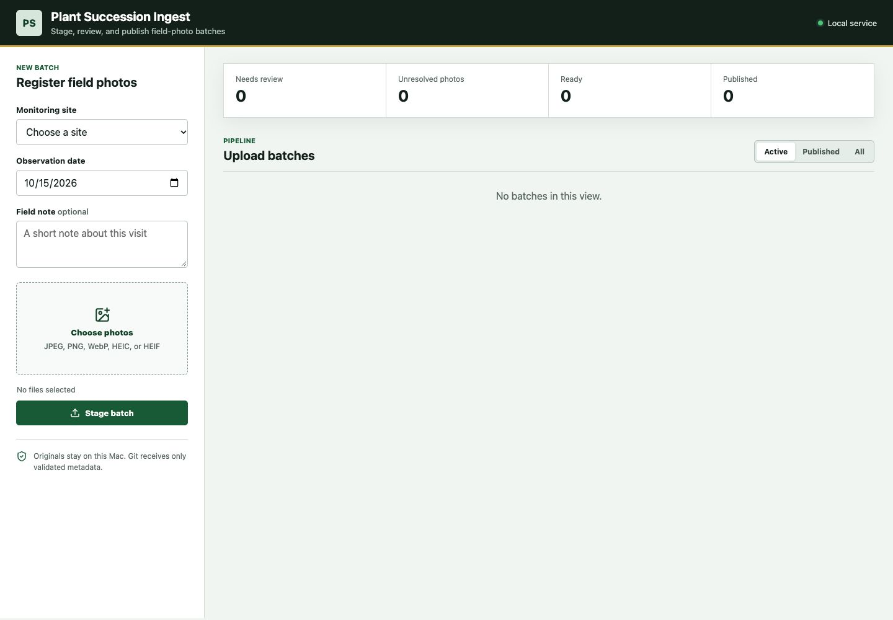

```bash
.venv/bin/pip install -e .
.venv/bin/python scripts/run_ingestion_app.py
```

Open `http://127.0.0.1:8765`. See [docs/ingestion_service.md](docs/ingestion_service.md) for the storage
contract, API, Render deployment, failure behavior, and model-labeling extension point. The included
`render.yaml` provisions a password-protected service and persistent storage for the mutable ingestion
state; deploying the upload workflow safely therefore requires paid Render compute and disk resources.

## Longitudinal Results

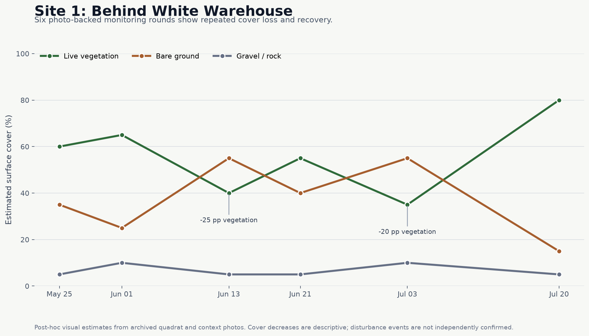

Site 1 now has six reviewed observations spanning May 25 through July 20. The photo-backed estimates
show two substantial decreases in live vegetation cover followed by recovery. Separate field notes record
mowing during the monitored period, with bounded event windows retained in the disturbance table. Missing
observation values remain explicit when the photos do not support a defensible estimate.

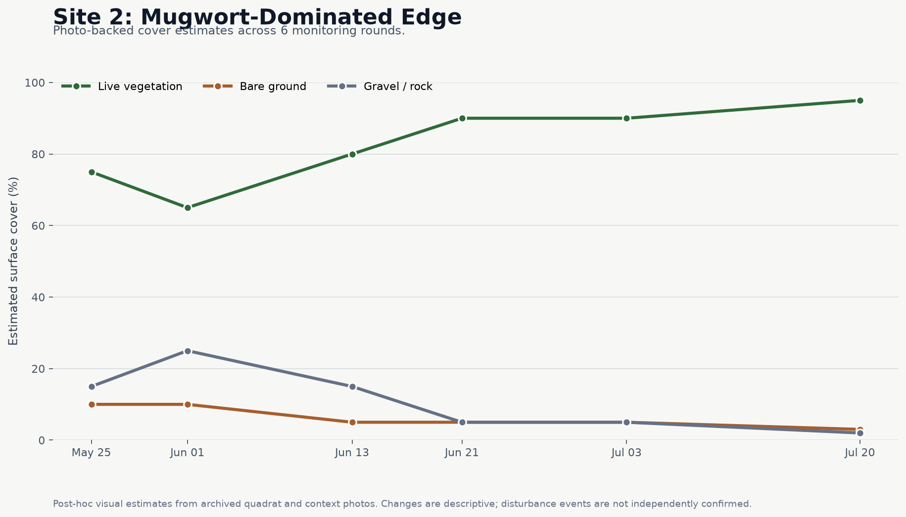

Site 2 provides a contrasting sequence: a mugwort-dominated roadside edge progresses toward nearly
continuous herbaceous cover. The June 1 dip may partly reflect quadrat framing, so it remains a descriptive
estimate rather than evidence of a disturbance event.

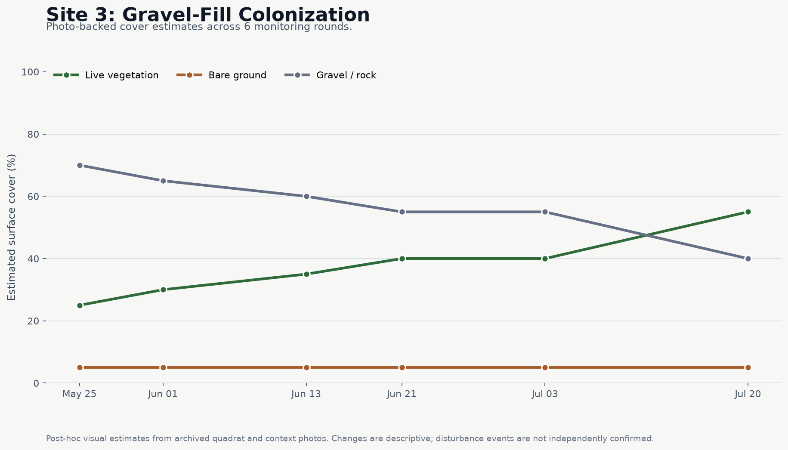

Site 3 follows colonization of coarse construction gravel. Vegetation remains concentrated along the
fence and trail margins but increases from an estimated 25% to 55% cover across the six rounds. A
prominent mugwort-like taxon is recorded as `Artemisia vulgaris` with `likely` confidence; the estimate
is not expert-verified, and no disturbance event is inferred from the sequence.

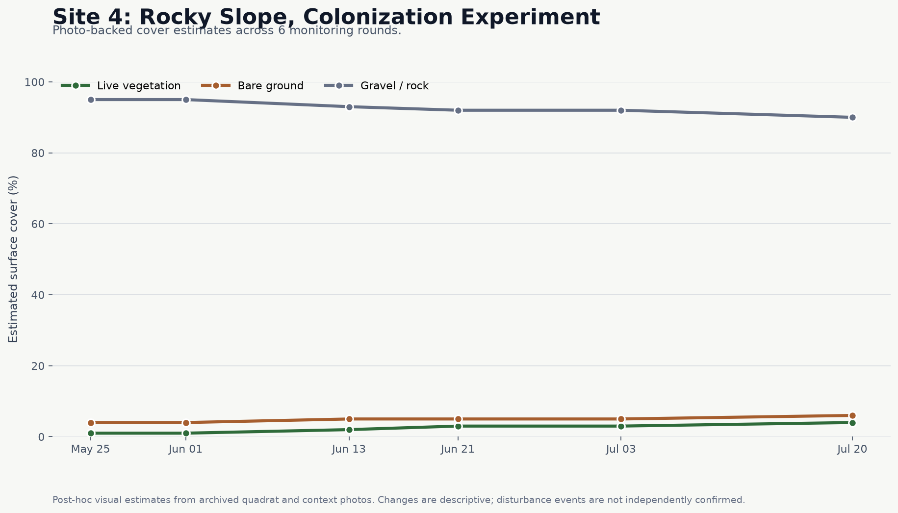

Site 4 tracks a newly installed gravel strip beside a fenced industrial property. Live vegetation remains
sparse but rises from an estimated 1% to 4% across six rounds while coarse aggregate remains the dominant
surface. Recurring plants are represented with stable morphotype labels because the photos do not support
confident species-level identification; no discrete disturbance is visible.

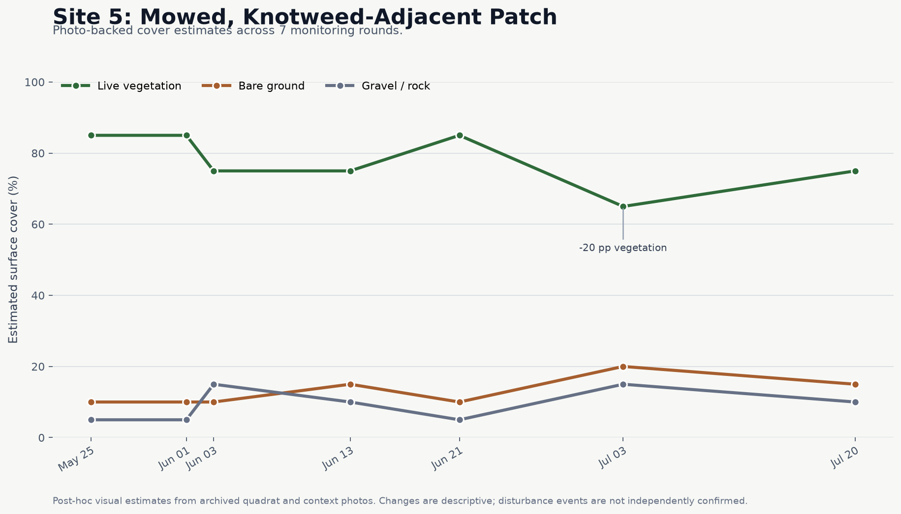

Site 5 contains seven photo-backed visits, including an additional June 3 round. The monitored woodland-edge
opening remains dominated by a short grass layer, with a July decline followed by partial recovery. A June 3
field note records likely same-day mowing, while uncertain edge plants are retained as stable morphotypes.

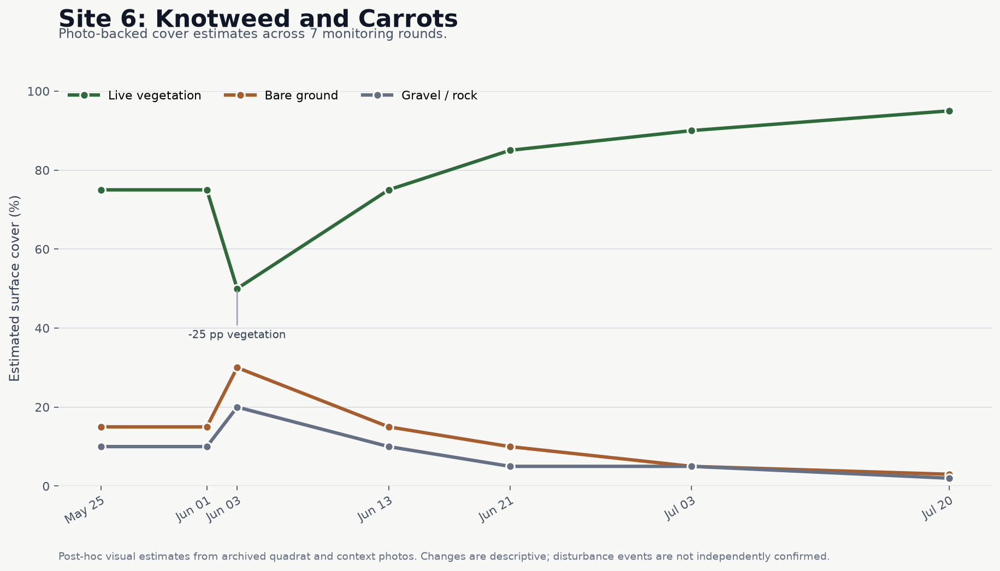

Site 6 follows a dense woodland-edge herb layer across seven photo-backed visits. Archived June 3 images show
freshly cut stems and leaves plus a 25 percentage-point decline in estimated live cover relative to June 1.
The matching field note and photo evidence support a `likely` mowing event within a bounded date window.
Cover then recovers steadily to an estimated 95% by July 20. The dominant dissected-leaf plant remains
a stable morphotype because the photographs do not support a defensible species-level identification.

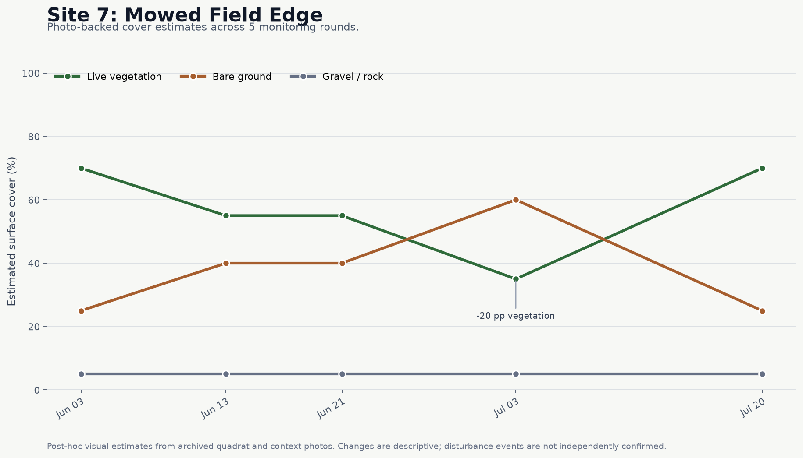

Site 7 follows a mowed field edge across five photo-backed visits. Estimated live cover declines from 70% on
June 3 to 35% on July 3, then rebounds to 70% by July 20 as grasses expand. Common mullein is retained at
`likely` confidence, while less certain recurring plants use stable morphotype labels. The photos do not show
enough evidence to infer a new mowing event during the monitored sequence.

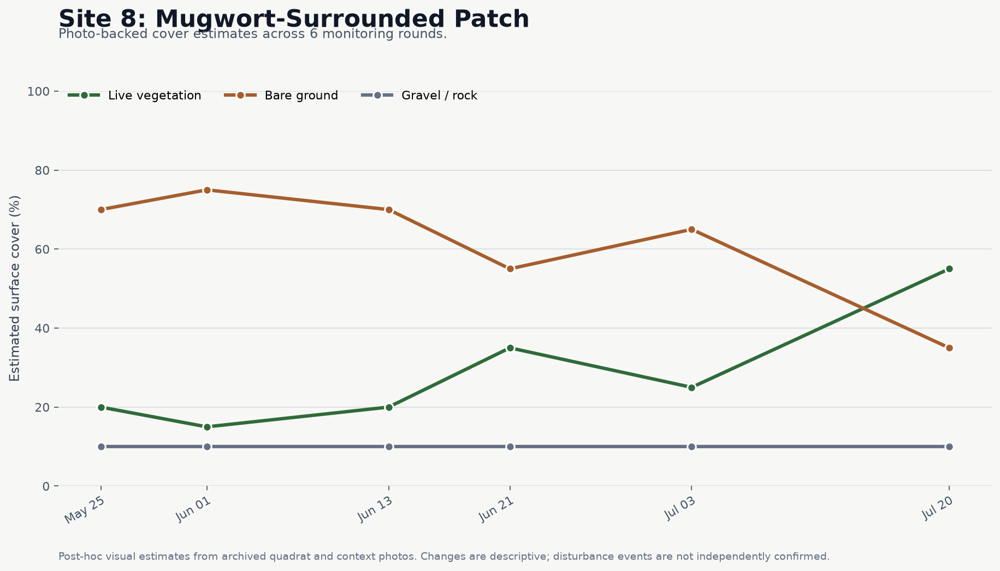

Site 8 follows a mostly exposed roadside patch across six photo-backed visits. The sequence shows substantial
grass-led infill by July 20 while retaining a bare center. June 21 includes more vegetated margin than adjacent
overhead frames, so the mid-sequence variation remains descriptive rather than evidence of disturbance. The
site name is historical context; the photos do not support a confident mugwort identification.

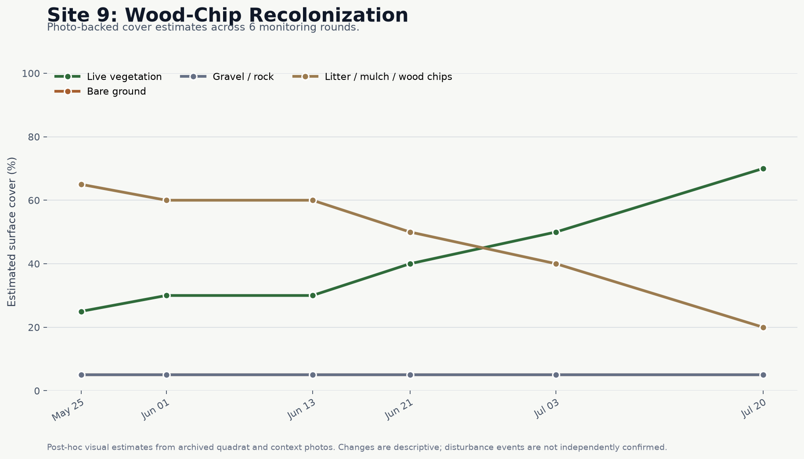

Site 9 follows recolonization of a wood-chip-covered woodland edge across six photo-backed visits. Estimated
live cover rises from 25% to 70% while visible wood-chip cover falls from 65% to 20%. Recurring plants are
retained as stable morphotypes because the photographs do not support species-level identification, and no
discrete disturbance event is inferred from the sequence.

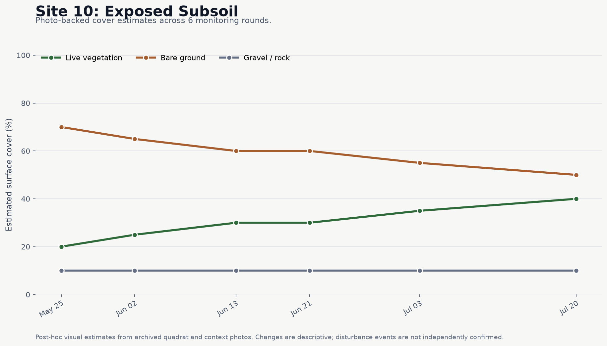

Site 10 follows colonization around a persistently exposed subsoil patch across six photo-backed visits.
Estimated live cover rises from 20% to 40%, primarily along the road and woodland margins, while roughly half
of the monitored surface remains bare by July 20. Recurring plants are retained as stable morphotypes, and the
sequence does not provide enough evidence to infer a new disturbance event.

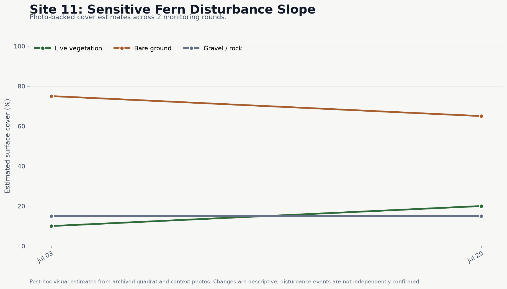

Site 11 is a later-established hillside site centered on an exposed soil-and-rubble mound. Across two
photo-backed visits, estimated live cover rises from 10% to 20% while exposed substrate remains dominant.
Sensitive fern is retained at `likely` confidence based on the field note and visible fern-like fronds; the
images do not support dating the earlier soil displacement or inferring a discrete new digging event.

## Review Workflow

The repository CSVs are the versioned, sanitized public record. A private Google Sheets workbook named
`Plant Succession ML - Data Review` mirrors those tables so photo-backed observations can be reviewed
and corrected without exposing Drive links or exact coordinates in GitHub.

Reviews are completed one site/date batch at a time. Photo roles are assigned only after visual
inspection, ecological values are recorded as rounded post-hoc estimates when the images support them,
and uncertain taxa remain blank or use an explicitly uncertain label. See
[docs/data_review_workflow.md](docs/data_review_workflow.md) for the synchronization rules.

## Research Question

How do disturbed urban edge habitats change over time after mowing, construction, soil disturbance, pruning, herbicide damage, flooding, and other disturbance events?

Secondary questions:

- Which taxa dominate shortly after disturbance?
- How quickly do bare ground, gravel, live vegetation, litter, and standing dead cover change?
- Do invasive edge species expand, recover, or decline after disturbance?
- Which sites move from early colonization toward dense herbaceous cover or shrub establishment?
- Can repeatable field photos and structured notes support ML-assisted change detection later?

## Data Sources

The project currently uses:

- Google My Maps / Google Earth site pins
- Google Drive folders containing the original field-photo archive
- A private Google Sheets workbook used for visual review and correction
- Sanitized CSV snapshots for sites, observations, source notes, site checks, disturbance events, and photos
- Post-hoc visual percent-cover estimates where the archived photos support them

Google Forms was the original collection design, but bulk photo uploads proved too slow in practice. The
real dataset is therefore reconstructed from the Drive archive with explicit provenance and missingness.

Raw photos, private Drive exports, and exact site data should not be committed directly to this public repository unless intentionally sanitized.

## Field Protocol Summary

Each monitoring visit creates one observation row per site visited. A routine visit records:

- site identifier
- observation date
- dominant, secondary, and tertiary taxa when visible
- taxonomic confidence and rank
- flowering and seed-set indicators
- estimated cover values for live vegetation, bare ground, gravel/rock, litter/mulch, and standing dead material
- notes about uncertainty, disturbance, or photo deviations

Recommended photo set per site visit:

- `wide_photo`: main repeatable site view
- `quadrat_photo`: ground-level or downward cover-estimation view
- `close_up_photo`: dominant or newly detected plants
- `context_photo_left`: left-side context view
- `context_photo_right`: right-side context view

Photo instructions use fixed landmarks, stable standing locations, consistent zoom, and phone gridline alignment where possible.

Annotated examples are available in [docs/protocol_photos/](docs/protocol_photos/).

## Repository Structure

```text
plant-succession-ml/
  README.md
  docs/
    field_protocol.md
    photo_protocol.md
    data_dictionary.md
    site_selection.md
    ml_roadmap.md
    portfolio_notes.md
  data/
    public/
    sample/
    schema/
    raw/
    processed/
  notebooks/
  src/plant_succession/
  scripts/
  outputs/
```

## Schema Overview

The project is organized around seven core tables:

- `site_registry`: one row per monitoring site
- `observations`: one row per site visit
- `field_notes`: one row per preserved source note, including non-disturbance notes
- `site_checks`: one row per explicitly assessed site and disturbance type
- `disturbance_events`: one row per observed or inferred disturbance event
- `photo_manifest`: one row per uploaded field photo
- `photo_batch_summary`: one row per site/date upload folder

The public photo manifest links each photo to a deterministic site/date observation ID without exposing
private Drive file IDs, links, or exact coordinates.

The disturbance lineage is deliberately conservative: only positive site checks create event rows,
explicit negative checks remain queryable, and sites omitted from a route note remain unknown.

Each schema file in `data/schema/` uses:

```text
field_name,data_type,required,allowed_values,description,example
```

## Current Limitations

- Species identifications are field estimates and are not expert-verified unless stated.
- Cover values are rounded post-hoc visual estimates rather than measurements made in fixed quadrats.
- Photo workflows are being revised because Google Forms file uploads can be awkward for large iPhone images.
- Successional-stage labels are interpretive and should not replace raw cover and taxon fields.
- No trained ML model is included yet.
- This is an independent portfolio project, not an official iNaturalist, municipal, or land-manager project.

## Analysis And ML Roadmap

Near-term work focuses on clean data collection and validation. Later stages include:

1. Manual structured observations
2. Repeatable photo archive
3. Cover-change summaries and disturbance-response plots
4. Taxon label cleanup
5. Image annotation experiments
6. Computer vision for vegetation cover and bare-ground segmentation
7. ML-assisted site-change detection
8. Public static report or dashboard

See [docs/ml_roadmap.md](docs/ml_roadmap.md) for the staged plan.

For portfolio and application framing, see [docs/visibility_plan.md](docs/visibility_plan.md).

## Quick Start

Install dependencies:

```bash
python -m pip install -r requirements.txt
```

Validate the sample and public data:

```bash
python scripts/validate_csvs.py
```

Rebuild the public photo metadata when a private Drive inventory export is available:

```bash
python scripts/build_photo_manifest.py
```

Initialize or refresh photo-backed observation rows while preserving reviewed fields:

```bash
python scripts/build_observation_backfill.py
```

Build the analysis-ready public table and Site 1 longitudinal figure:

```bash
python scripts/build_longitudinal_outputs.py
```

Export sample sites with coordinates to GeoJSON:

```bash
python scripts/export_geojson.py
```
