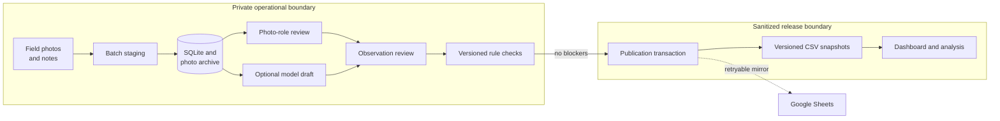

# Architecture And Data Lineage

The system is designed around one operational source of truth, explicit review provenance, and a narrow
public-release boundary. Raw images, exact anchors, credentials, and mutable workflow state stay private;
only sanitized metadata and derived outputs are versioned in Git.

## System View

## Data Lineage

| Stage | Stored artifact | Provenance and control |
| --- | --- | --- |
| Capture | Original photos and field notes | Private files retain EXIF and source wording; exact coordinates never enter public exports. |
| Stage | Batch, photo, hash, EXIF, and integrity rows in SQLite | Content hashes prevent duplicates; per-file site/date outliers require explicit resolution. |
| Photo review | Append-only role-review events | Human labels, rules, and model suggestions remain distinguishable by actor, method, time, and revision. |
| Observation review | Revisioned cover, taxon, phenology, and completeness fields | Blank means unavailable; machine drafts stay suggestions until a human deliberately saves them. |
| Verification | Append-only rule runs and findings | Each run is tied to the exact observation revision; blockers stop publication and warnings request judgment. |
| Publication | One local transaction plus a publication-run record | SQLite commits first. A Sheets failure is recorded for retry and cannot roll back valid local data. |
| Release | Sanitized tables in `data/public/` | Deterministic IDs, stable schemas, validation, and content hashes make snapshots reviewable in Git. |
| Analysis | `analysis_ready_observations.csv`, figures, and dashboard queries | Derived outputs preserve missingness and can be rebuilt from the canonical tables. |

## Engineering Decisions

| Decision | Why |
| --- | --- |
| SQLite is canonical; CSV is the public release format | SQLite provides transactions and relational constraints locally. CSV keeps sanitized releases diffable, portable, and easy to validate. |
| Review and verification are append-only events | Later corrections do not erase who or what produced an earlier label. |
| Machine drafts never overwrite human work | Automation is useful for triage, but evidence, uncertainty, and reviewer accountability must remain visible. |
| Validation separates blockers from warnings | Impossible or contradictory states cannot publish; uncertain ecological judgments remain reviewable rather than silently discarded. |
| Photo hashes and deterministic record IDs are stable | Re-imports, duplicate detection, and public snapshots can be compared without relying on filenames or upload order. |
| Google Sheets is an optional one-way mirror | A familiar editing/reporting surface is useful, but network or credential failures must not create split-brain state. |
| The public demo is synthetic and read-only | The complete product can be evaluated without exposing raw photos, exact locations, credentials, or the operational database. |
| The operational and demo Render Blueprints are separate | The private service needs authentication and durable disk; the portfolio demo should be disposable, secret-free, and inexpensive. |

## Operating Modes

- **Operational:** `scripts/run_ingestion_app.py` uses private SQLite and photo paths. Render configuration
  lives in `render.yaml` and requires authentication plus persistent storage.
- **Public demo:** `scripts/run_demo.py --reset` seeds disposable `.demo/` storage from committed public
  metadata and generated synthetic images. `render.demo.yaml` provisions this mode without secrets or disk.
- **Release:** `scripts/manage_data_store.py export` rebuilds public snapshots, and
  `scripts/validate_csvs.py` checks the repository data contract before commit.

## Failure Behavior

- Duplicate or outlier photos stop at batch review instead of being silently assigned.
- A deterministic verification blocker prevents publication; warnings remain visible with remediation text.
- Machine-review jobs have durable queued, running, completed, and failed states and can be retried.
- Publication is transactional locally. Optional Sheets synchronization is separately logged and retryable.
- The hosted demo rejects non-read requests at server middleware, even if a browser control is bypassed.
