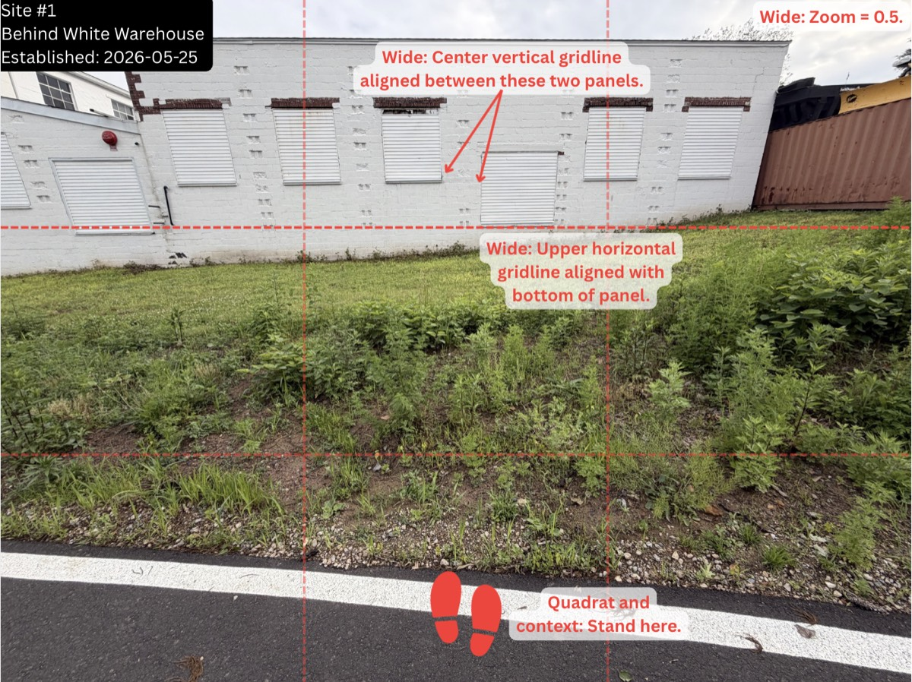
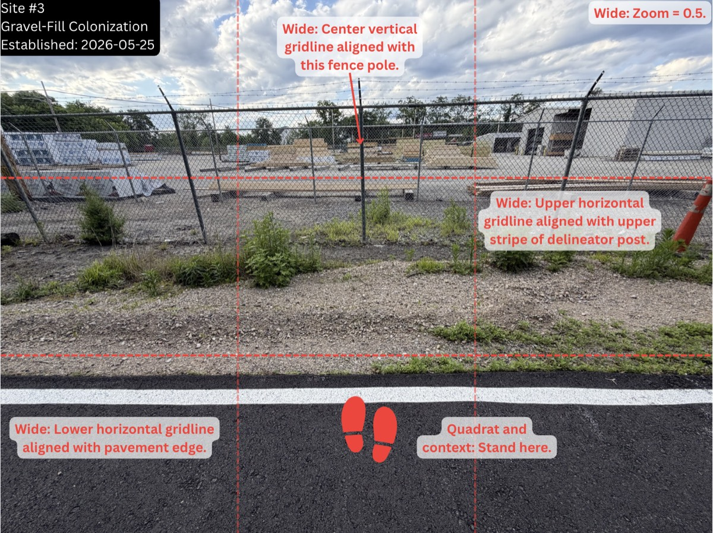
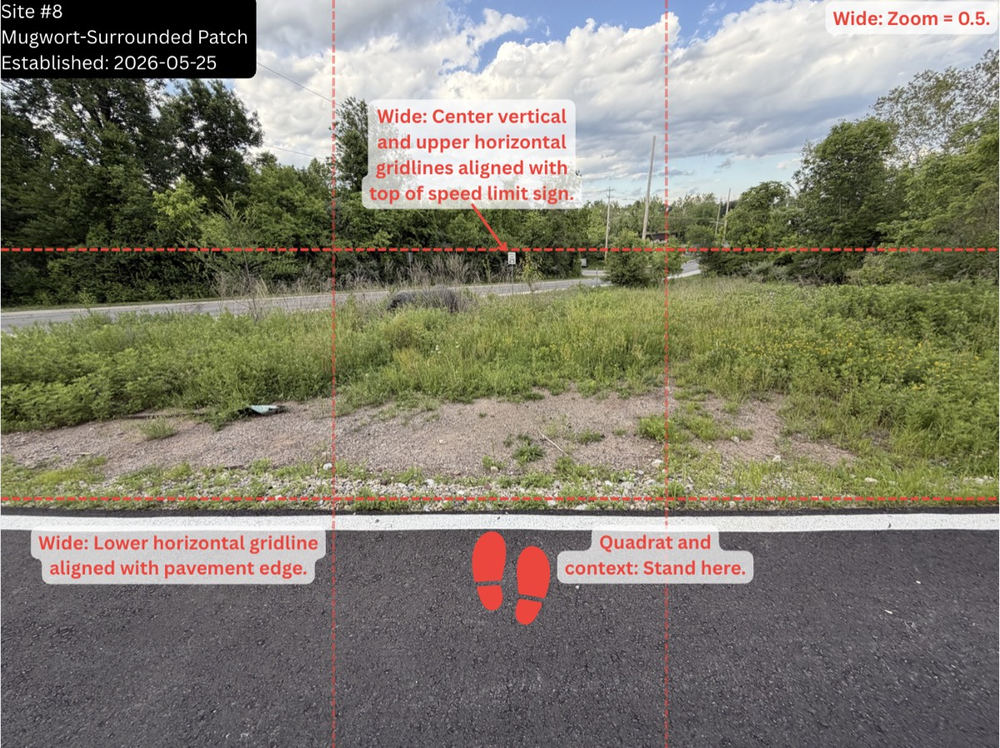
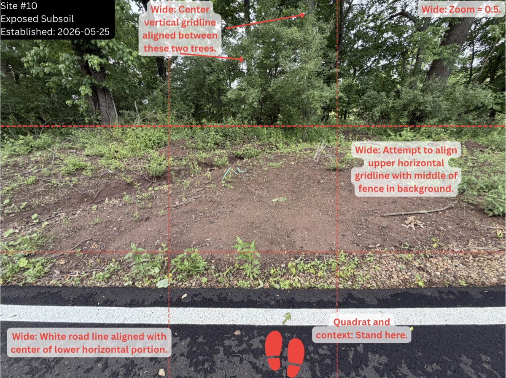

# Protocol Photo Examples

These compressed screenshots document the repeatable field-photo protocol. The original full-resolution screenshots are kept outside the repository; this folder contains a small representative gallery for public review.

The annotations show:

- site identifier and working site name
- establishment date
- photo type and zoom
- standing location
- gridline alignment instructions
- repeatable visual anchors such as fence posts, road edges, building edges, signs, trees, and utility poles

## Selected Examples

### Site 1: Wide Photo

### Site 3: Gravel-Fill Colonization

### Site 8: Mugwort-Surrounded Patch

### Site 10: Exposed Subsoil

## Complete Protocol Manifest

The full original screenshot set is listed in [photo_manifest.tsv](photo_manifest.tsv). Each row records the original screenshot filename, recommended public filename, site, photo role, and protocol notes. Only selected examples are committed as compressed images in this public MVP.

These images are protocol documentation, not model-training data. Raw field photos and full-resolution exports should stay out of Git unless intentionally curated for public release.
